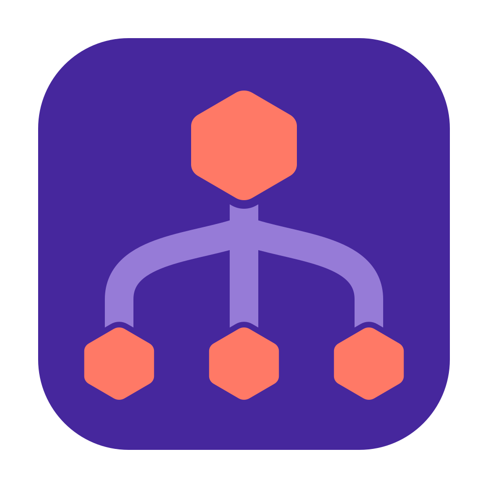

# agent-config

Global instructions, plugins, skills and MCP servers for coding agents (Claude Code, Codex, Grok, OpenCode, Pi), kept identical on every machine you use. It assumes [T3 Code](https://github.com/pingdotgg/t3code) for orchestration, [pstack](https://github.com/cursor/plugins) for subagent roles, and a tailnet between your machines.

This repo is a public, anonymized mirror of a working setup. It updates automatically whenever the original changes. Everything that's specific to one person or one computer is left out; you supply your own in `~/.agent-config/local/`, and sync never overwrites it.

## What gets built

Each tool's global instruction file (`~/.claude/CLAUDE.md`, `~/.codex/AGENTS.md`, …) is built from these layers, in order:

| Layer | From | What it holds |
| --- | --- | --- |
| `core` | `core.md` (this repo) | How to work: finishing jobs, models and subagents, where subagents run, dev servers, shell gotchas |
| `providers/*` | `providers/claude-code.md`, `providers/codex.md` | Tool-specific additions |
| `personal` | `~/.agent-config/local/personal.md` | You: git identity, tailnet, your remote box's T3 IDs |
| `machine` | `~/.agent-config/local/machines/<machine>.md` | This computer: hostname, drives, quirks |

`manifest.json` lists the plugins, skills and MCP servers to install. `skills/` holds skills kept in this repo; everything else is pulled from upstream (mattpocock/skills, t3dotgg/tstack, emilkowalski/skills). `pstack-models.md` is copied to `~/.claude/rules/` and sets pstack's model per role.

## Set up a machine

Needs `git` and `python3` (3.9+). Repeat on each machine, with a different machine name each time.

```sh
git clone https://github.com/memfactorduke/agent-config-public.git ~/.agent-config/repo
echo laptop > ~/.agent-config/machine            # any short name for this computer

mkdir -p ~/.agent-config/local/machines
cp ~/.agent-config/repo/examples/local/personal.md ~/.agent-config/local/personal.md
cp ~/.agent-config/repo/examples/local/machines/laptop.md ~/.agent-config/local/machines/laptop.md
# edit both: your git identity, tailnet, remote box IDs, this machine's notes

python3 ~/.agent-config/repo/bin/agent-config render laptop /tmp/preview   # look first, writes nothing
python3 ~/.agent-config/repo/bin/agent-config sync
```

The first `sync` backs up any existing instruction files to `~/.agent-config/backups/` before replacing them. Move anything you want to keep into `personal.md` or the machine file.

Keep `personal.md` identical on every machine (a dotfiles repo or a synced folder works). Only the machine file differs.

### Run it daily

macOS:

```sh
cp ~/.agent-config/repo/service/agent-config.plist ~/Library/LaunchAgents/local.agent-config.plist
launchctl load ~/Library/LaunchAgents/local.agent-config.plist
```

Linux (systemd user timer):

```sh
mkdir -p ~/.config/systemd/user
cp ~/.agent-config/repo/service/agent-config.{service,timer} ~/.config/systemd/user/
systemctl --user daemon-reload && systemctl --user enable --now agent-config.timer
loginctl enable-linger "$USER"     # keep it running when you're logged out
```

Both run at boot and at 05:00. The repo always wins: a local edit to a built file is backed up, then overwritten. Make changes in `~/.agent-config/local/` instead.

## Your own plugins, skills and MCP servers

Put a `manifest.json` in `~/.agent-config/local/`. Its lists are appended to this repo's, its objects are merged in, and `dir`/`src` paths in it are relative to `~/.agent-config/local/`. See `examples/local/manifest.json`.

- `machines`: name your computers and their `os` (`mac` or `linux`) so `"machines": "macs"` entries resolve. Without it, each machine's OS is detected.
- `skill_sources`: `{"name": "mine", "dir": "skills", "skills": {"my-skill": "all"}}` installs `~/.agent-config/local/skills/my-skill` everywhere. Use a list of machine names instead of `"all"` to limit it.
- `mcp`, `plugins`: same shape as this repo's entries.
- `drift_url`: a private git repo. With one set, local edits to built files are committed to a `drift/<machine>` branch there before they're overwritten, and `agent-config drift` shows them.

## Commands

```
agent-config sync            pull the repo, rebuild everything
agent-config sync --cleanup  also remove skills nothing manages (backed up first)
agent-config render M DIR    write machine M's instruction files into DIR, nothing else
agent-config status          what's managed here, plus unmanaged extras
agent-config drift           local edits saved to the drift repo, if you set one up
```

## Changing the shared parts

`core.md`, the provider files, the skills and the manifest come from upstream and are replaced on every sync. To change them for yourself, fork this repo and point `~/.agent-config/repo` at your fork (`git -C ~/.agent-config/repo remote set-url origin <your fork>`); pull from this repo into your fork when you want updates.
